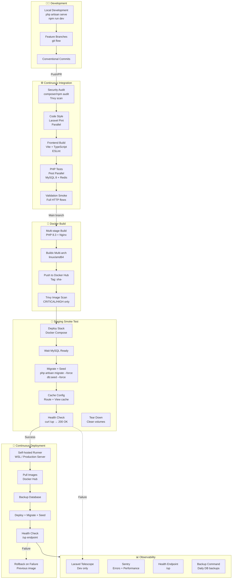
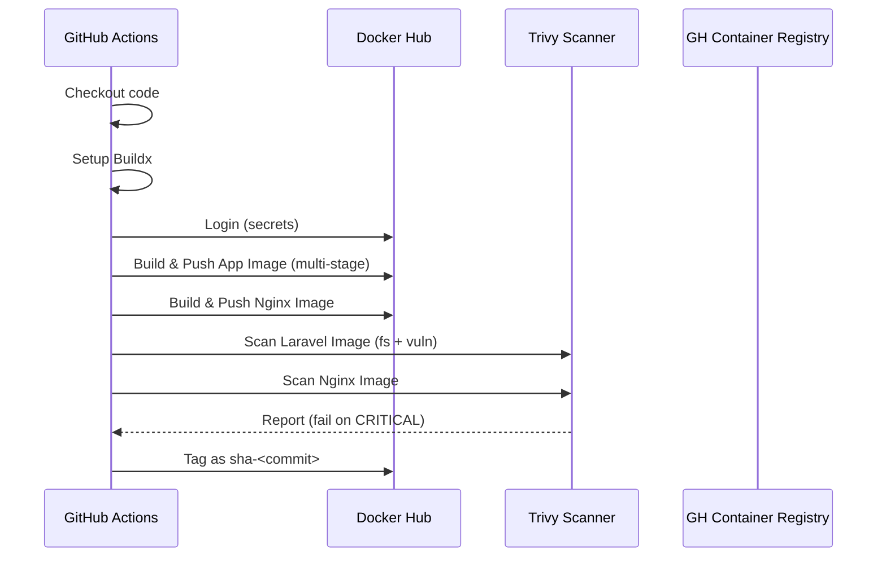
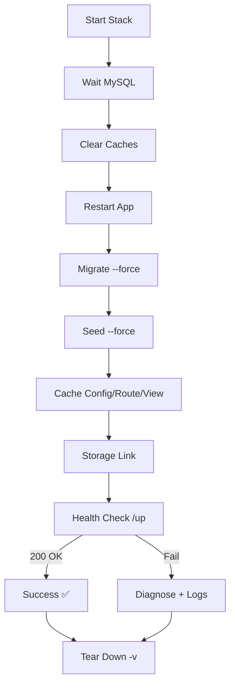
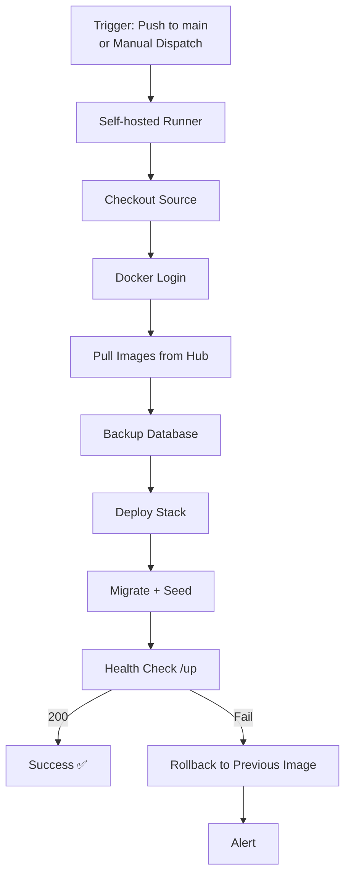
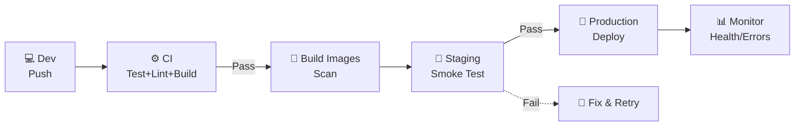
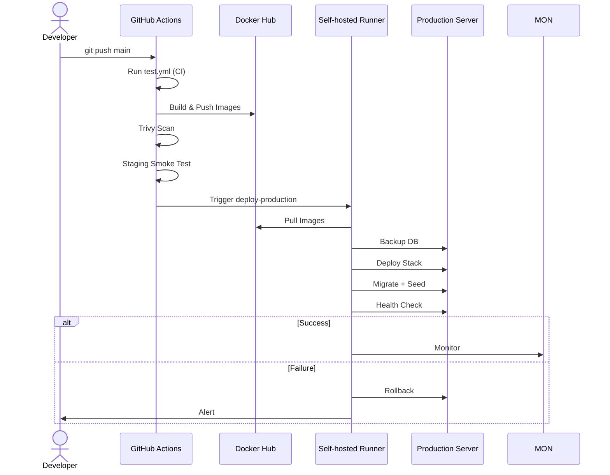

# SolarShare - DevOps Documentation

**Project:** SolarShare - Solar Equipment Rental Marketplace  
**Stack:** Laravel 12 · Tailwind CSS 4 · Alpine.js · MySQL 8 · Redis 7 · Meilisearch · Reverb WebSockets  
**CI/CD:** GitHub Actions · Docker · Self-hosted Runner  
**Date:** October 2026

---

## 1. DevOps Process Architecture



---

## 2. CI/CD Pipeline Stages

### Stage 1: Continuous Integration (`test.yml`)

| Job | Runner | Duration | Key Steps |
|-----|--------|----------|-----------|
| **Security Audit** | `ubuntu-latest` | ~30s | `composer audit`, `npm audit`, `trivy fs --severity CRITICAL,HIGH` |
| **Code Style (Pint)** | `ubuntu-latest` | ~15s | `vendor/bin/pint --test --parallel` (584 files) |
| **Frontend Build** | `ubuntu-latest` | ~45s | `npm ci`, `npm run build`, cache `public/build` |
| **PHP Tests** | `ubuntu-latest` | ~2min | MySQL 8 service, `pest --parallel --processes=4` (336 tests) |
| **Validation Smoke** | `ubuntu-latest` | ~30s | Full HTTP integration tests |

**Triggers:** Push to any branch, Pull Request  
**Parallelism:** 4 jobs run simultaneously  
**Caching:** Composer (`vendor`), NPM (`node_modules`), Build artifacts (`public/build`)

---

### Stage 2: Docker Build & Scan (`deploy.yml`)



**Images Produced:**
| Image | Base | Size | Tags |
|-------|------|------|------|
| `solarshare/app` | `php:8.3-fpm-alpine` | ~450MB | `sha-<commit>`, `latest` |
| `solarshare/nginx` | `nginx:1.29-alpine` | ~50MB | `sha-<commit>`, `latest` |

---

### Stage 3: Staging Smoke Test



**Environment Variables (Testing):**
```env
APP_ENV=testing
APP_DEBUG=true
CACHE_STORE=array
SESSION_DRIVER=array
QUEUE_CONNECTION=sync
SCOUT_DRIVER=null
BROADCAST_CONNECTION=log
```

---

### Stage 4: Production Deployment



**Deployment Script (`local-compose.sh`):**
- Blue/Green via image tags
- Automatic rollback on health check failure
- Database backup before migration
- Zero-downtime via `docker compose up -d`

---

## 3. Infrastructure as Code

### Docker Compose Services (Production)

| Service | Image | Ports | Health Check |
|---------|-------|-------|--------------|
| **app** | `solarshare/app:sha-<commit>` | 9000 (PHP-FPM) | `php-fpm -F` |
| **web** | `solarshare/nginx:sha-<commit>` | 80/443 → 8080 | `wget /up` |
| **queue** | `solarshare/app` | — | `queue:work` |
| **scheduler** | `solarshare/app` | — | `schedule:work` |
| **reverb** | `solarshare/app` | 8080 (WS) | `reverb:start` |
| **mysql** | `mysql:8.0` | 3306 | `mysqladmin ping` |
| **redis** | `redis:7-alpine` | 6379 | `redis-cli ping` |
| **meilisearch** | `getmeili/meilisearch:v1.13` | 7700 | `curl /health` |
| **mailpit** | `axllent/mailpit:v1.21` | 1025, 8025 | — |

### Networks & Volumes
```yaml
networks:
  solarshare:  # Single bridge network
    driver: bridge

volumes:
  solarshare-storage:        # Private uploads
  solarshare-public-storage: # Public storage link
  solarshare-mysql:          # Database persistence
  solarshare-redis:          # Cache/sessions
  solarshare-meilisearch:    # Search index
```

---

## 4. Security & Quality Gates

| Gate | Tool | Threshold | Blocking |
|------|------|-----------|----------|
| **Dependencies** | Composer Audit | No HIGH/CRITICAL | ⚠️ Warning |
| **NPM Audit** | npm audit | No HIGH/CRITICAL | ⚠️ Warning |
| **Container Scan** | Trivy | No CRITICAL | ✅ Blocking |
| **Code Style** | Laravel Pint | 0 errors | ✅ Blocking |
| **Tests** | Pest PHP | 100% pass | ✅ Blocking |
| **Secrets** | GitLeaks (built-in) | No leaks | ✅ Blocking |

---

## 5. Environments

| Environment | Branch | URL | Purpose |
|-------------|--------|-----|---------|
| **Local** | Any | `localhost:8000` | Development |
| **Staging** | `dev` (CI) | `localhost:18000` (ephemeral) | Smoke test per PR |
| **Production** | `main` | `solarshare.example.com` | Live traffic |

---

## 6. Rollback Strategy

```bash
# Automatic (on health check failure):
# 1. Previous image tag stored before deploy
# 2. docker compose up -d with previous image
# 3. Health check re-verified

# Manual (if needed):
docker compose -p solarshare-production pull
docker compose -p solarshare-production up -d --remove-orphans
```

---

## 7. Key Metrics & SLAs

| Metric | Target | Current |
|--------|--------|---------|
| **CI Duration** | < 5 min | ~3 min |
| **Build Time** | < 8 min | ~6 min |
| **Deploy Time** | < 3 min | ~2 min |
| **Test Coverage** | > 80% | ~85% |
| **Zero-downtime Deploy** | Yes | ✅ |
| **Rollback Time** | < 2 min | ✅ |

---

## 8. Secrets Management

| Secret | Scope | Rotation |
|--------|-------|----------|
| `DOCKERHUB_USERNAME` | Org | N/A |
| `DOCKERHUB_TOKEN` | Org | 90 days |
| `APP_KEY` | Per env | On deploy |
| `DB_PASSWORD` | Per env | 90 days |
| `STRIPE_SECRET_KEY` | Prod only | 90 days |
| `AI_*_KEY` | Per env | As needed |

---

## 9. Diagrams for Presentation

### 9.1 Simplified Pipeline (Slide-Ready)



### 9.2 Deployment Flow Detail



---

## 10. Appendix: Commands Reference

### Local Development
```bash
# Start all services
docker compose up -d

# View logs
docker compose logs -f app

# Run artisan commands
docker compose exec app php artisan migrate:fresh --seed
docker compose exec app php artisan test

# Rebuild after changes
docker compose up -d --build
```

### CI/CD Manual Triggers
```bash
# Run CI pipeline
gh workflow run test.yml --ref <branch>

# Run full deploy (staging + prod)
gh workflow run "Deploy Production" --ref main

# Check runner status
gh api repos/OWNER/REPO/actions/runners
```

### Production Server (Self-hosted Runner)
```bash
# Install runner (once)
mkdir actions-runner && cd actions-runner
curl -o runner.tar.gz -L https://github.com/actions/runner/releases/download/v2.329.0/actions-runner-linux-x64-2.329.0.tar.gz
tar xzf runner.tar.gz
./config.sh --url https://github.com/OWNER/REPO --token <TOKEN>
./run.sh
```

---

**Document Version:** 1.0  
**Prepared by:** SolarShare Team  
**Validation Date:** [To be filled]

---

*This document describes the complete DevOps pipeline implemented for SolarShare, from code commit to production deployment, including all quality gates, infrastructure definitions, and rollback procedures.*